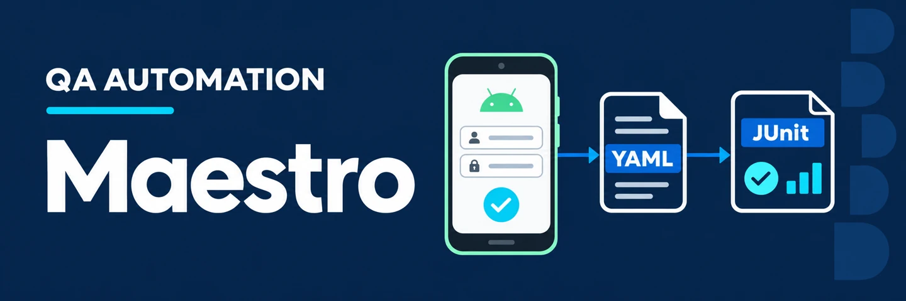
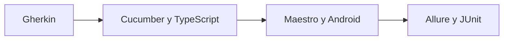

# Maestro + Cucumber + Allure

Pruebas E2E para Android con una app de demostración incluida. Cucumber describe los escenarios, TypeScript invoca los flujos YAML de Maestro y Allure y JUnit conservan los resultados.

[Inicio rápido](#inicio-rápido) · [Flujo de prueba](#flujo-de-prueba) · [QA asistido por IA](#qa-asistido-por-ia) · [GitHub Actions](https://github.com/Jlaucel/TS-Maestro-Cucumber/actions/workflows/qa.yml)

## Qué incluye

- **App de prueba incluida.** La app usa datos sintéticos para verificar la aceptación y el rechazo de un código.
- **Flujos YAML reutilizables.** Maestro ejecuta el mismo flujo con diferentes entradas y resultados esperados.
- **Diagnóstico móvil.** Cada escenario conserva JUnit y diagnósticos. Maestro MCP permite inspeccionar la interfaz y ejecutar flujos desde un cliente local.

## Inicio rápido

Usa Node.js 24, JDK 17, Android SDK Platform 35, Build Tools 35.0.0, Gradle 8.11.1 y Maestro CLI 2.12.1 en el PATH. Inicia un emulador Android, configura `ANDROID_HOME` y comprueba la conexión con `adb devices`. [Instalación del CLI de Maestro](https://docs.maestro.dev/maestro-cli/how-to-install-maestro-cli)

```bash
npm ci
gradle :android-fixture:assembleDebug
adb install -r android-fixture/build/outputs/apk/debug/android-fixture-debug.apk
npm test
npm run report
```

Para validar la suite sin emulador, ejecuta `npm run qa:check`, `npm run typecheck` y `npm run dry-run`. Para seleccionar un caso en el dispositivo, usa `npm test -- --tags '@QA-MOB-102'`.

## Flujo de prueba



Los casos `QA-MOB-101` y `QA-MOB-102` verifican la aceptación de un código válido y el rechazo de un código corto. Cucumber los ejecuta en serie en un dispositivo. Los archivos JUnit y los diagnósticos se guardan en `artifacts/maestro/`. Usa `ALLURE_RESULTS_DIR` para guardar los resultados Allure de cada ejecución en un directorio propio. [Ver los escenarios](features/verification.feature)

También puedes ejecutar el flujo positivo directamente con `maestro test -e PIN=2468 -e EXPECTED_ID=qa_accepted .maestro/verification.yaml`. Si Maestro genera capturas de fallo, el adaptador las adjunta al reporte Allure.

| Ruta | Contenido |
| --- | --- |
| [`features/verification.feature`](features/verification.feature) | Escenarios Gherkin en español. |
| [`steps/verification.ts`](steps/verification.ts) | Pasos TypeScript y captura de evidencias. |
| [`.maestro/verification.yaml`](.maestro/verification.yaml) | Flujo Maestro usado por los dos escenarios. |
| [`android-fixture/`](android-fixture/) | App Android de demostración. |

## QA asistido por IA

| Skill de Codex | Cuándo usarla |
| --- | --- |
| [`$qa-design`](.agents/skills/qa-design/SKILL.md) | Diseñar escenarios BDD según criterios de aceptación y riesgo. |
| [`$qa-triage`](.agents/skills/qa-triage/SKILL.md) | Preparar un diagnóstico con los resultados y la evidencia de una ejecución. |
| [`$qa-integrations`](.agents/skills/qa-integrations/SKILL.md) | Relacionar diseños, criterios y casos con sus pruebas. |

`npm run qa:triage` resume los resultados Allure después de una ejecución. Los hooks de Codex orientan el flujo de diseño y diagnóstico. La guía también explica cómo habilitar Maestro MCP localmente. [Guía ISTQB y hooks](docs/qa.md)

Configura **Figma, Jira, Zephyr y Slack** en tu cliente local con acceso autorizado. [Guía de conexiones](docs/integraciones-qa.md)

---

**Colección QA Automation de Yunior Laucel**

[Cypress](https://github.com/Jlaucel/TS--Cypress-Cucumber) · [Playwright](https://github.com/Jlaucel/TS-Playwrigth-Cucumber) · [WebdriverIO](https://github.com/Jlaucel/TS-WebdriverIO-Cucumber) · **Maestro** · [yuniorlaucel.com](https://yuniorlaucel.com)
